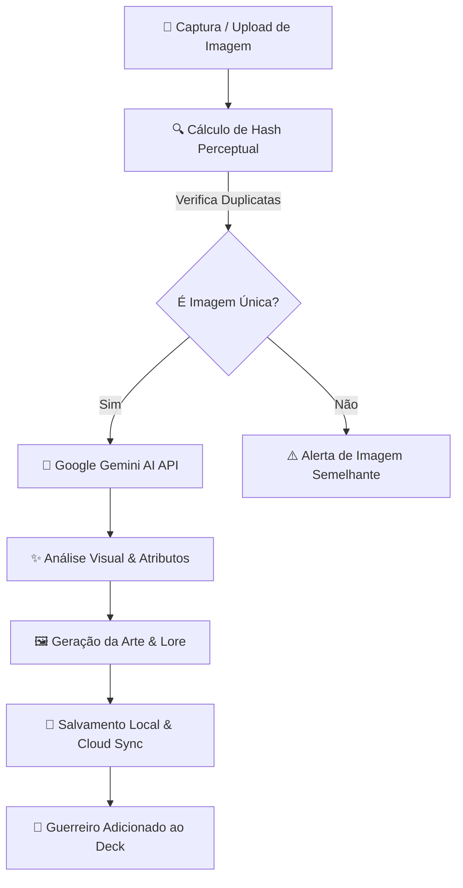
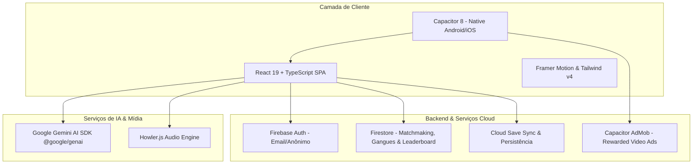
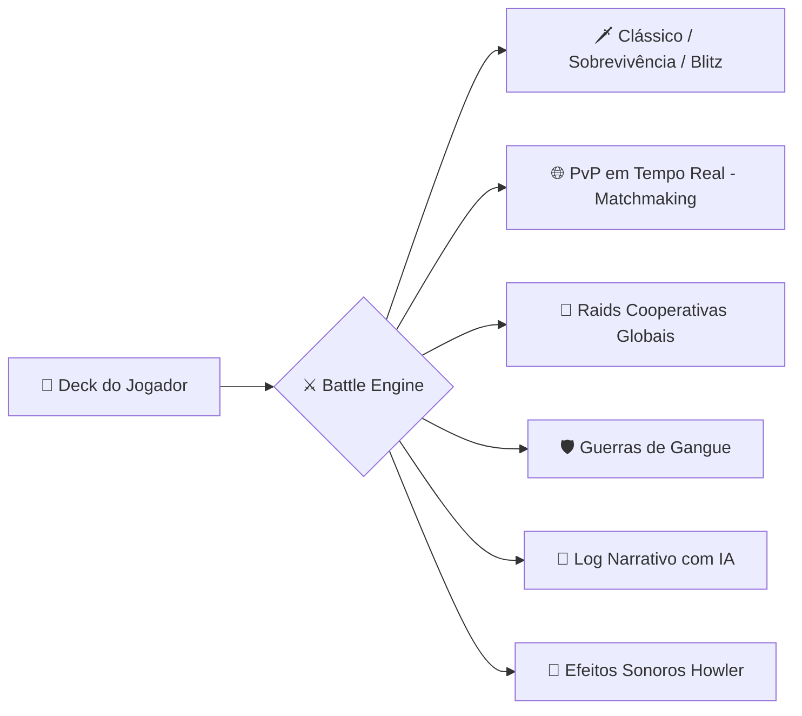

# ⚔️ Nano Verse

> **AI-Powered Creature Collection & Battle RPG**  
> Transforme objetos e imagens do mundo real em guerreiros digitais únicos utilizando a **Google Gemini AI**!

---

## 🌟 Visão Geral (Overview)

O **Nano Verse** é uma aplicação RPG tática e colecionável para Web e dispositivos móveis (iOS & Android). O jogo combina captura de imagem via câmera com a **Inteligência Artificial Generativa (Google Gemini)** para transformar fotos cotidianas em guerreiros com atributos, elementos, habilidades e retratos visualmente estilizados.

### 🎮 Principais Funcionalidades

- 📸 **AI Scanner & Geração de Guerreiros**: Escaneie qualquer foto ou objeto do mundo real para que a IA analise características físicas e crie um guerreiro com atributos (*HP, Atk, Def, Spd*), classe, raridade, história e arte exclusiva.
- 🧬 **Câmara de Fusão (Fusion Chamber)**: Combine dois guerreiros da sua coleção para sintetizar uma nova entidade híbrida de maior raridade e habilidades exclusivas.
- ⚔️ **Arena de Batalha Multimodo**:
  - **PvE Clássico**: Combate tático por turnos contra oponentes e bots.
  - **Modo Sobrevivência & Blitz**: Desafios de resistência com rodadas aceleradas.
  - **Chefes de Raid**: Batalhas comunitárias cooperativas contra chefes globais.
  - **PvP em Tempo Real**: Matchmaking em nuvem e partidas contra outros jogadores.
  - **Guerras de Gangues**: Combates representativos de guilda.
- 🛡️ **Guildas & Social (Gangs)**: Crie ou entre em gangues, converse no chat de guilda, ative buffs exclusivos e participe de guerras de aliança.
- 🏆 **Economia & Progressão**: Sistema de níveis de jogador, ranks ELO (*Bronze a Legend*), troféus/conquistas, mercado negro e recompensas em anúncios (AdMob).
- 📱 **Multiplataforma Nativo**: Funciona nativamente em navegadores Web, Android e iOS utilizando **Capacitor 8**.

---

## 📊 Diagramas de Arquitetura & Fluxos

### 1. 🔄 Fluxo de Geração do Guerreiro (AI Scanner Engine)



---

### 2. 🏛️ Arquitetura Geral do Sistema (System Architecture)



---

### 3. ⚔️ Sistema de Batalha (Battle Engine Topology)



---

## 🛠️ Stack Tecnológica

| Categoria | Tecnologias Utilizadas |
| :--- | :--- |
| **Frontend Framework** | React 19, TypeScript 5.8, Vite 6 |
| **Estilização & Animações** | Tailwind CSS v4, Framer Motion (`motion/react`), Lucide React |
| **Mobile Cross-Platform** | Capacitor 8 (Android & iOS), `@capacitor/camera`, `@capacitor-community/admob` |
| **Inteligência Artificial** | Google Gemini AI (`@google/genai`) |
| **Backend & Cloud Services** | Firebase (Authentication, Cloud Firestore, Realtime, Cloud Save) |
| **Áudio & Mídia** | Howler.js, HTML2Canvas, QRCode.react |

---

## 🚀 Como Executar o Projeto

### Pré-requisitos

- **Node.js**: `v18.x` ou superior
- **npm**: `v9.x` ou superior

### 1. Clonar o Repositório & Instalar Dependências

```bash
git clone https://github.com/sxnraku/nano.git
cd nano
npm install
```

### 2. Configurar Variáveis de Ambiente

Crie um ficheiro `.env` na raiz do projeto com a sua chave da **Google Gemini AI**:

```env
GEMINI_API_KEY="Sua_Chave_Google_Gemini_Aqui"
```

### 3. Iniciar o Servidor de Desenvolvimento

```bash
npm run dev
```
Acesse a aplicação em `http://localhost:3000`.

### 4. Outros Comandos Úteis

```bash
# Verificação de Tipos (Lint/TSC)
npm run lint

# Build de Produção Web
npm run build

# Sincronizar projeto nativo Android (Capacitor)
npm run android:sync

# Abrir no Android Studio
npm run android:open
```

---

## 📝 Licença

Este projeto está sob a licença [MIT](LICENSE).
