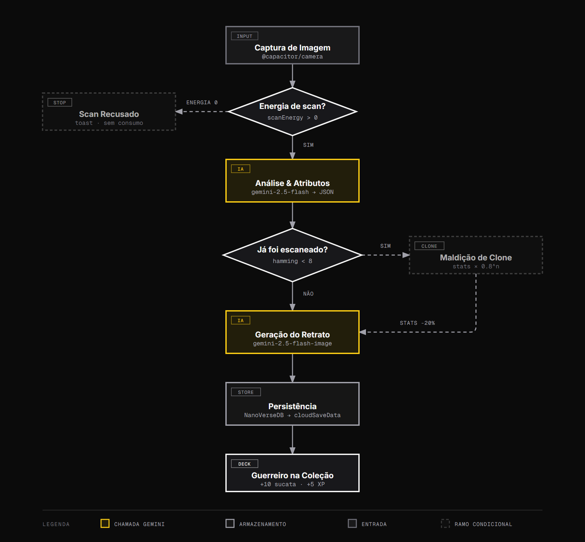
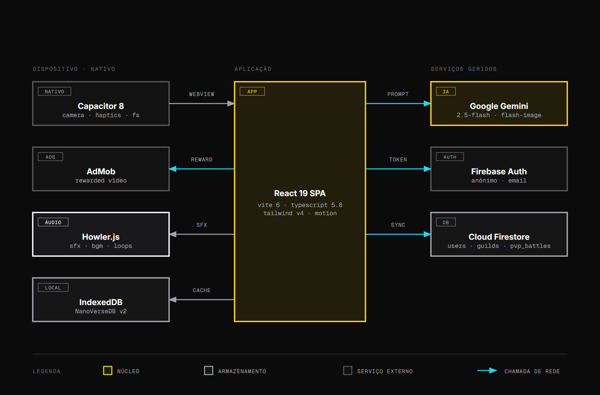
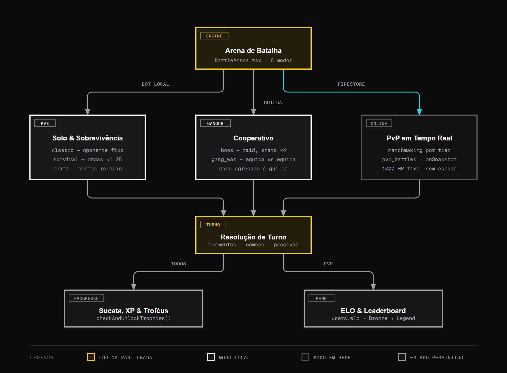

# ⚔️ Nano Verse

> **AI-Powered Creature Collection & Battle RPG**  
> Transforme objetos e imagens do mundo real em guerreiros digitais únicos utilizando a **Google Gemini AI**!

---

## 🌟 Visão Geral (Overview)

O **Nano Verse** é uma aplicação RPG tática e colecionável para Web e dispositivos móveis (iOS & Android). O jogo combina captura de imagem via câmera com a **Inteligência Artificial Generativa (Google Gemini)** para transformar fotos cotidianas em guerreiros com atributos, elementos, habilidades e retratos visualmente estilizados.

### 🎮 Principais Funcionalidades

- 📸 **AI Scanner & Geração de Guerreiros**: Escaneie qualquer foto ou objeto do mundo real para que a IA analise características físicas e crie um guerreiro com atributos (*HP, Atk, Def, Spd*), classe, raridade, história e arte exclusiva.
- 🧬 **Câmara de Fusão (Fusion Chamber)**: Combine dois guerreiros da sua coleção para sintetizar uma nova entidade híbrida de maior raridade e habilidades exclusivas.
- ⚔️ **Arena de Batalha Multimodo**:
  - **PvE Clássico**: Combate tático por turnos contra oponentes e bots.
  - **Modo Sobrevivência & Blitz**: Desafios de resistência com rodadas aceleradas.
  - **Chefes de Raid**: Batalhas comunitárias cooperativas contra chefes globais.
  - **PvP em Tempo Real**: Matchmaking em nuvem e partidas contra outros jogadores.
  - **Guerras de Gangues**: Combates representativos de guilda.
- 🛡️ **Guildas & Social (Gangs)**: Crie ou entre em gangues, converse no chat de guilda, ative buffs exclusivos e participe de guerras de aliança.
- 🏆 **Economia & Progressão**: Sistema de níveis de jogador, ranks ELO (*Bronze a Legend*), troféus/conquistas, mercado negro e recompensas em anúncios (AdMob).
- 📱 **Multiplataforma Nativo**: Funciona nativamente em navegadores Web, Android e iOS utilizando **Capacitor 8**.

---

## 📊 Diagramas de Arquitetura & Fluxos

> Os diagramas abaixo são renderizados a partir de ficheiros HTML self-contained (SVG inline, sem build e sem JavaScript) em [`docs/diagrams/`](docs/diagrams/). Abra qualquer um deles diretamente no browser para ver a versão editorial completa.

### 1. 🔄 Fluxo de Geração do Guerreiro (AI Scanner)



São **dois** pedidos distintos ao Gemini. Primeiro `gemini-2.5-flash` devolve os metadados em JSON — nome, classe, elemento, stats, raridade, lore e o `visualPrompt`. Só depois `gemini-2.5-flash-image` gera o retrato a partir desse prompt.

O hash percetual **não bloqueia** a criação: se a distância de Hamming contra um scan anterior for `< 8`, o guerreiro nasce mesmo assim, mas com a *maldição de clone* — `stats × 0.8ⁿ` (onde `n` é o número de repetições do objeto) e o prefixo `[CLONE]` no nome.

<sub>📄 [`01-scanner-pipeline.html`](docs/diagrams/01-scanner-pipeline.html) &nbsp;·&nbsp; 💻 [`src/App.tsx`](src/App.tsx), [`src/services/gemini.ts`](src/services/gemini.ts), [`src/utils/imageHash.ts`](src/utils/imageHash.ts)</sub>

---

### 2. 🏛️ Arquitetura Geral do Sistema



Não existe backend próprio. A SPA React é a espinha dorsal: à esquerda fala com os plugins nativos expostos pelo Capacitor e com o armazenamento local; à direita fala com serviços geridos. Tudo o que atravessa a rede está a ciano.

A persistência é dupla — a coleção completa (incluindo imagens base64) vive em **IndexedDB** (`NanoVerseDB v2`, fora da quota do `localStorage`), e o save é espelhado no campo `cloudSaveData` do documento `users/{uid}` no Firestore.

<sub>📄 [`02-arquitetura-sistema.html`](docs/diagrams/02-arquitetura-sistema.html) &nbsp;·&nbsp; 💻 [`src/services/firebase.ts`](src/services/firebase.ts), [`src/services/gemini.ts`](src/services/gemini.ts), [`src/services/storage.ts`](src/services/storage.ts)</sub>

---

### 3. ⚔️ Sistema de Batalha



Os seis modos (`classic`, `survival`, `blitz`, `boss`, `gang_war`, `pvp`) entram todos no mesmo componente e divergem apenas em **duas** coisas: a origem do adversário e a escala de dificuldade. A resolução de turno — elementos, combos e passivas — é partilhada por todos.

O PvP é o único modo que não usa escala de stats: ambos os lados começam com 1000 HP fixos e o estado da sessão é sincronizado via listener `onSnapshot` na coleção `pvp_battles`.

<sub>📄 [`03-motor-de-batalha.html`](docs/diagrams/03-motor-de-batalha.html) &nbsp;·&nbsp; 💻 [`src/components/BattleArena.tsx`](src/components/BattleArena.tsx), [`src/utils/elo.ts`](src/utils/elo.ts)</sub>

---

## 🛠️ Stack Tecnológica

| Categoria | Tecnologias Utilizadas |
| :--- | :--- |
| **Frontend Framework** | React 19, TypeScript 5.8, Vite 6 |
| **Estilização & Animações** | Tailwind CSS v4, Framer Motion (`motion/react`), Lucide React |
| **Mobile Cross-Platform** | Capacitor 8 (Android & iOS), `@capacitor/camera`, `@capacitor-community/admob` |
| **Inteligência Artificial** | Google Gemini AI (`@google/genai`) — `gemini-2.5-flash` e `gemini-2.5-flash-image` |
| **Backend & Cloud Services** | Firebase — Authentication (anónimo/email), Cloud Firestore (`users`, `guilds`, `challenges`, `pvp_battles`, `matchmaking`), sync em tempo real via `onSnapshot` |
| **Persistência Local** | IndexedDB (`NanoVerseDB v2`) para coleção e ícones |
| **Áudio & Mídia** | Howler.js, HTML2Canvas, QRCode.react |

---

## 🚀 Como Executar o Projeto

### Pré-requisitos

- **Node.js**: `v18.x` ou superior
- **npm**: `v9.x` ou superior

### 1. Clonar o Repositório & Instalar Dependências

```bash
git clone https://github.com/sxnraku/nano.git
cd nano
npm install
```

### 2. Configurar Variáveis de Ambiente

Crie um ficheiro `.env` na raiz do projeto com a sua chave da **Google Gemini AI**:

```env
GEMINI_API_KEY="Sua_Chave_Google_Gemini_Aqui"
```

### 3. Iniciar o Servidor de Desenvolvimento

```bash
npm run dev
```
Acesse a aplicação em `http://localhost:3000`.

### 4. Outros Comandos Úteis

```bash
# Verificação de Tipos (Lint/TSC)
npm run lint

# Build de Produção Web
npm run build

# Sincronizar projeto nativo Android (Capacitor)
npm run android:sync

# Abrir no Android Studio
npm run android:open
```

---

## 📝 Licença

Este projeto está sob a licença [MIT](LICENSE).
